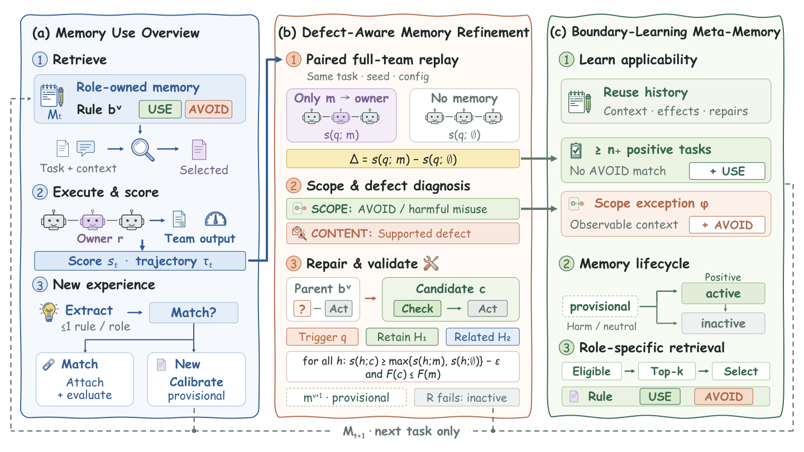

# DiscernMem

[English](README.md) | **中文**

论文 *Remembering Is Not Enough: Refining Memories and Learning When to Use
Them in Multi-Agent Systems* 的代码。



*DiscernMem 概览。(a) 一个任务周期中的记忆使用：检索、团队执行与评分，以及新经验。(b) DMR：配对重放、适用范围与缺陷诊断，以及经过验证的修复。(c) BLM：适用性学习、生命周期管理，以及面向角色的检索。更新仅影响后续任务。*

DiscernMem 是一个面向大模型多智能体系统、无需训练的记忆框架。每条记忆都是归属于某一个角色的行为规则。每个任务评分之后，DiscernMem 判断一次有害的复用是规则本身有缺陷，还是规则被用在了不合适的场景，并分别处理：

- **缺陷感知记忆修复（DMR）**：分别在"只给记忆所属角色提供这一条记忆"和"不提供任何记忆"两种条件下重放任务，根据轨迹诊断内容缺陷；修复只有在触发任务和更早的任务上都不退化时才被接受。
- **边界学习元记忆（BLM）**：记录每条记忆的使用情况和测得的效果，并依据所属角色行动前可见的上下文，学习该角色何时应使用、何时应回避这条记忆。
- 新经验按角色抽取，先通过身份匹配与已有记忆比对，再在相似的历史任务上校准。记忆在 provisional、active、inactive 三种状态间流转。

每个任务都先完成评分，之后其经验才能更新记忆；更新只影响后续任务。

支持的多智能体系统：**AutoGen**、**CAMEL**、**MacNet**。
支持的基准：**TriviaQA**、**PopQA**、**KodCode**、**PDDL**（AgentBoard）。

## 目录结构

```text
discernmem/           方法本体
  centralized_adapter.py   MAS 宿主调用的接口（按角色检索、任务完成后的处理）
  controller.py            任务后的主流程：重放、诊断、修复、元记忆、准入
  replay.py scheduling.py  配对重放（单条记忆 vs. 无记忆）
  usage_assessor.py counterexamples.py   适用性判断与缺陷归因
  repair_generator.py cpe.py validation.py   修复候选与跨任务验证
  meta_memory.py meta_summarizer.py effect.py   使用/回避条件与效果记录
  pipeline.py admission_controller.py identity_judge.py semantic_index.py   抽取与准入
  retrieval.py retrieval_selector.py   按角色过滤的检索与选择
  state_engine.py          生命周期（provisional / active / inactive）
  storage.py               JSON 记忆库与可读报告
  config.py                方法配置
  prompt/                  方法自身的 prompt 与 JSON schema
mas/                  AutoGen、CAMEL、MacNet 宿主，agent 与消息图
  <mas>/prompts/prompt.py           同时存放供记忆方法使用的该 MAS 指导（MEMORY_*）
data/                 各基准的环境、数据加载与交互循环
  pddl/agentboard_pddlgym/ 随仓库附带的 AgentBoard PDDLGym（见"第三方代码与数据"）
common/               LLM/embedding 客户端、QA 检索设置、启动器、统计
  memory_guidance.py   各基准的任务指导，以及供记忆方法查找 MAS/任务指导的函数
configs/
  benchmarks/          各基准的运行设置（protocol 段）
  discernmem/          方法默认配置、消融变体、扫描定义
scripts/
  run.py               运行单个实验
  run_sweep.py         运行消融组或超参扫描
  run_benchmarks.py    底层运行器（全部参数）
  report.py materialize_views.py   从已完成的记忆库生成指标与报告
docs/reproduce_zh.md  完整复现指南
docs/figures/         上方的概览图
```

## 安装

使用 Linux 和 Python 3.10，通过 conda 创建主程序环境：

```bash
conda create -n discernmem python=3.10 pip -y
conda activate discernmem
python -m pip install -r requirements.txt
python -m pip check
```

主程序环境已在 Python 3.10、PyTorch 2.10 下验证，具体依赖版本见
`requirements.txt`。所有命令都在仓库根目录下运行，无需安装成包。
模型服务和检索服务使用独立环境，见[复现指南](docs/reproduce_zh.md#1-环境)。

## 服务

DiscernMem 通过 OpenAI 兼容接口调用以下服务：

| 服务 | 模型 | 用途 |
|---|---|---|
| Chat completions | Qwen3-4B-Instruct-2507 | 所有智能体及方法内部的全部 LLM 调用 |
| Embeddings | Qwen3-Embedding-0.6B | 记忆检索、身份匹配、验证任务选择 |
| 检索（`POST /retrieve`） | Search-R1 e5，基于 2018 年 Wikipedia | 仅 TriviaQA 和 PopQA |

各服务的启动命令见 `docs/reproduce_zh.md`。然后复制环境变量模板并填写地址：

```bash
cp .env.example .env
```

`LLM_MODEL` 和 `DISCERNMEM_EMBED_MODEL` 必须与服务端实际提供的模型名一致。

## 快速开始

```bash
# 完整运行一组设置
python scripts/run.py --benchmark kodcode --mas camel

# 主结果的全部 12 组设置
for benchmark in triviaqa popqa kodcode pddl; do
  for mas in autogen camel macnet; do
    python scripts/run.py --benchmark "$benchmark" --mas "$mas"
  done
done
```

启动服务并配置 `.env` 后，在主程序 `discernmem` 环境中运行上述命令。
各基准的设置和结果处理见[复现指南](docs/reproduce_zh.md)。

`--` 之后的参数会原样传给 `scripts/run_benchmarks.py`。

## 输出

每次运行写入 `results/<run_id>/`：

```text
results/<run_id>/
  configs/<benchmark>_<mas>_discernmem.yaml    冻结的方法配置
  <benchmark>/<mas>/discernmem/
    results/eval_results.json     最终汇总（pass_rate 为 [0, 1] 区间内的平均任务得分）
    results/task_results.jsonl    每个任务一行
    logs/run.log                  完整日志
    memory/discernmem/records/    权威记忆库（JSON）
    memory/discernmem/reports/    可读的记忆报告（index.md）
```

## 配置

- `configs/benchmarks/<benchmark>.yaml`：数据集、生成与交互设置；`protocol` 段是 `scripts/run.py` 使用的运行设置（任务数、轮数、环境模式、重放并发等）。
- `configs/discernmem/default.yaml`：完整方法。

任务清单在启动时根据基准的 protocol 自动生成，因此配置文件都很短。`--dry-run` 会打印对应的配置指纹。

## 第三方代码与数据

- `data/pddl/agentboard_pddlgym/` 是 [AgentBoard](https://github.com/hkust-nlp/AgentBoard) 发布的 PDDLGym 包及 PDDL 题目的原样副本，未作修改（AgentBoard 代码为 Apache-2.0，数据为 GPL-2.0；其来源 PDDLGym 为 MIT 许可）。`data/pddl/test.jsonl` 为 AgentBoard 数据集中的 60 道 PDDL 测试题（GPL-2.0）。许可原文见 `data/pddl/agentboard_pddlgym/LICENSES/`。
- KodCode-Light-RL-10K（CC BY-NC 4.0）、TriviaQA（Apache 2.0）、PopQA（来自 MIT 许可的仓库）首次使用时从 Hugging Face Hub 下载。
- QA 检索使用 [Search-R1](https://github.com/PeterGriffinJin/Search-R1) 的检索服务及其基于 2018 年 Wikipedia 的 e5 索引。

## 许可

本项目自有代码使用 [MIT 许可](LICENSE)，版权署名为 Copyright (c) 2026 DiscernMem Contributors。部分代码改编自以 MIT 许可发布的 ConMem 代码。附带的第三方代码与数据、以及运行时下载的数据集均保留各自的许可，详见 [THIRD_PARTY_NOTICES.md](THIRD_PARTY_NOTICES.md)。
